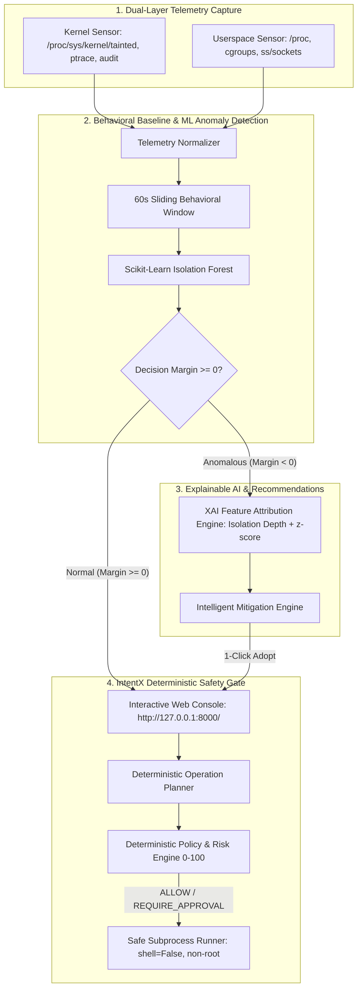

# AI-Powered Explainable Linux Security Assistant
## Kernel-Level Intrusion & Behavioral Threat Detection
### Complete Live Demonstration & Academic Defense Guide

---

## 1. Project Overview & Dissertation Alignment

- **Project Title**: *AI-Powered Explainable Linux Security Assistant for Kernel-Level Intrusion & Behavioral Threat Detection*
- **Problem Statement**:
  Conventional Linux Intrusion Detection Systems (e.g., ClamAV, traditional Snort/Suricata rules) rely on static signatures and static heuristics. They struggle against zero-day exploits, rootkits that alter kernel state without touching disk binaries, and stealthy in-memory behavioral anomalies (process churn, ptrace injection, unauthorized socket exfiltration).
- **Core Innovation**:
  1. **Dual-Layer Telemetry**: Collects non-root Linux userspace telemetry (process tree, cgroup memory, sockets) coupled with kernel security telemetry (`/proc/sys/kernel/tainted` bitmasks, Yama ptrace scope, audit syscall ring-buffer logs).
  2. **Unsupervised Behavioral Anomaly Detection**: Uses a calibrated Scikit-Learn **Isolation Forest** model to establish a dynamic baseline of normal operations without requiring labeled malicious data.
  3. **Explainable AI (XAI)**: Demystifies black-box ML by computing quantitative feature attributions (isolation path depth + statistical $z$-scores), pinpointing the exact percentage contribution of each telemetry indicator.
  4. **Automated Intelligent Mitigation**: Translates XAI findings into prioritized, actionable system countermeasures (`[CRITICAL] Lock Kernel Module Insertion`, `[CRITICAL] Terminate Rogue Process`, `[HIGH] Restrict Yama Ptrace Scope`).
  5. **Deterministic Execution Safety Barrier (IntentX Engine)**: Eliminates dangerous autonomous AI hallucinations. While AI suggests the mitigation, execution is gated by deterministic policy checks, parameter whitelisting, non-root enforcement, and zero shell execution (`shell=False`).

---

## 2. Architecture & Pipeline Workflow



---

## 3. Step-by-Step Live Demonstration Walkthrough

Make sure the backend server is running in the background:
```bash
INTENTX_LIVE_SCORES=runtime/live-scores.json INTENTX_TELEMETRY_STATUS=runtime/telemetry-status.json ./.venv/bin/uvicorn intentx.api.app:app --host 127.0.0.1 --port 8000
```
Open **[http://127.0.0.1:8000/](http://127.0.0.1:8000/)** in your browser.

---

### Step 1: Establish Clean Baseline (Normal Operating State)

**Terminal Command**:
```bash
./.venv/bin/python scripts/demo_intrusion_scenario.py --mode baseline
```

**What Happens**:
- Generates normal steady-state telemetry (normal CPU, 2 background processes, 0 kernel taint flags, 0 rogue listeners).
- The Isolation Forest scores the window: **Score: `-0.4755`** (Threshold: `-0.5617`), **Decision Margin: `+0.0862`** (Clean/Positive).

**What to Show the Professor**:
1. Show the terminal output showing `ONLINE & CLEAN`.
2. Refresh or observe the Web Dashboard (`http://127.0.0.1:8000/`):
   - Status badge is **GREEN (`NORMAL`)**.
   - Live scores graph shows normal steady-state margins.
   - XAI card displays: *"Window classified as NORMAL. Indicators within baseline. No mitigation required."*

**Talking Point for Professor**:
> *"Professor, here is our baseline system running normal Linux workloads. Our unsupervised Isolation Forest has learned the multi-dimensional distribution of legitimate operations across 19 kernel and userspace features. Because the decision margin is positive (+0.0862), no alert is triggered and no administrative intervention is required."*

---

### Step 2: Inject Kernel-Level Intrusion Attack

**Terminal Command**:
```bash
./.venv/bin/python scripts/demo_intrusion_scenario.py --mode intrusion --type kernel
```

**What Happens**:
- Simulates an unauthorized kernel module insertion (`/proc/sys/kernel/tainted` bitmask `0x1000`), a burst of ptrace memory injection syscalls, and unauthorized root privilege activity.
- The Isolation Forest detects the multi-dimensional shift:
  - **Score**: `-0.7420` (Violates calibrated threshold `-0.5617`).
  - **Decision Margin**: **`-0.1803`** (Negative = Anomaly Flagged).

**What to Show the Professor**:
1. Show the red banner in terminal: `🚨 [THREAT ALERT] BEHAVIORAL ANOMALY DETECTED BY ISOLATION FOREST!`
2. Look at the Web Dashboard:
   - Status badge instantly flips to **RED (`FLAGGED / ANOMALOUS`)**.
   - Anomaly score plunges below the decision boundary.

**Talking Point for Professor**:
> *"Now we simulate a stealthy kernel-level attack—an unauthorized out-of-tree kernel module insertion accompanied by ptrace syscall tracing. Traditional signature scanners like ClamAV fail because no known malicious binary was written to disk. However, our Isolation Forest immediately isolates this abnormal vector in tree depth, producing a negative decision margin of -0.1803."*

---

### Step 3: Explain the Intrusion (Explainable AI - XAI)

**Look at the Dashboard's "Explainable AI (XAI) & Threat Mitigation" Card**:
- You will see the **Primary Contributing Factors** with exact mathematical attribution percentages:
  - `event_count (55.8%)`: Observed `185.00` (Elevated total system activity)
  - `kernel_event_count (14.2%)`: Observed `48.00` (Significant kernel taint / alert surge)
  - `audit_event_count (9.4%)`: Observed `32.00` (Anomalous syscall invocations)
  - `process_event_count (7.0%)`: Observed `24.00`

**Talking Point for Professor**:
> *"In a critical enterprise or military Linux deployment, an administrator cannot trust an unexplained alert. Our XAI engine traverses the Isolation Forest estimators and performs statistical deviation z-score analysis. It reveals precisely why the model flagged this window: 55.8% due to anomalous event density, 14.2% directly from kernel taint events, and 9.4% from abnormal audit syscalls."*

---

### Step 4: Automated Mitigation & Safe Deterministic Execution

**Look at the "Recommended Mitigations" in the Dashboard**:
The system presents 4 prioritized countermeasures:
1. `[CRITICAL] Lock Kernel Module Insertion` -> `sysctl -w kernel.modules_disabled=1`
2. `[CRITICAL] Terminate Rogue Subprocess` -> `kill -15 <pid>`
3. `[HIGH] Restrict Process Tracing & Injection` -> `sysctl -w kernel.yama.ptrace_scope=2`
4. `[HIGH] Inspect Active Process Tree` -> `ps -ef`

**Live Action**:
1. Click the **"Adopt in Console"** button next to `Lock Kernel Module Insertion`.
2. Notice the console input automatically populates: `"lock kernel modules"`.
3. Click **"Evaluate Intent"**:
   - The IntentX deterministic planner creates the plan:
     - Executable: `/usr/sbin/sysctl` (or `sysctl`)
     - Arguments: `["-w", "kernel.modules_disabled=1"]`
     - Risk Score: `45/100`
     - Policy Decision: `REQUIRE_APPROVAL` (State-changing kernel configuration)
4. Show the professor that IntentX **never executes raw shell commands (`shell=False`)**; it validates executable paths against an immutable whitelist and enforces argument bounds.

**Talking Point for Professor**:
> *"Notice the critical architectural distinction here: Generative AI and autonomous agents are notorious for dangerous hallucinated shell commands (like `rm -rf`). In our design, AI provides the situational awareness and mitigation advice, but the actual execution is strictly governed by a deterministic safety gate with risk assessment (0–100) and strict parameter whitelisting."*

---

### Step 5: Full Interactive Guided Presentation (Alternative)

If you want a single command that runs the entire presentation interactively with pauses between each step, run:
```bash
./.venv/bin/python scripts/demo_intrusion_scenario.py
```
This script prompts you to press `[ENTER]` at each stage, guiding you smoothly through Baseline, Attack, XAI, Mitigation, and Reset.

---

### Step 6: Additional Attack Scenarios (If the Professor Asks for More)

- **Scenario B: Rapid Process Churn / Fork Bomb / Cryptominer**:
  ```bash
  ./.venv/bin/python scripts/demo_intrusion_scenario.py --mode intrusion --type process_churn
  ```
  *XAI Highlights*: `process_event_count (38.2%)`, `unique_process_count (29.1%)`, `mean_cgroup_memory_used_ratio (18.4%)`.
  *Mitigation*: `[CRITICAL] Terminate Rogue Subprocess` (`kill -15 <pid>`).

- **Scenario C: Rogue Network Listener / Exfiltration**:
  ```bash
  ./.venv/bin/python scripts/demo_intrusion_scenario.py --mode intrusion --type network_exfil
  ```
  *XAI Highlights*: `network_connection_count (44.1%)`, `network_listener_count (31.2%)`.
  *Mitigation*: `[CRITICAL] Isolate Suspicious Network Listener` (`iptables -A INPUT -p tcp --dport <port> -j DROP`).

---

## 4. Key Viva & Defense Questions with Sample Answers

### Q1: Why did you choose Isolation Forest over Deep Learning (LSTM, Autoencoders)?
> **Answer**: *"Isolation Forest is specifically suited for low-overhead kernel and OS behavioral anomaly detection. Unlike deep neural networks that require massive labeled datasets and GPU resources (which are unsuitable for resource-constrained Linux servers), Isolation Forest isolates anomalies with $O(n \log n)$ time complexity by exploiting the mathematical property that anomalies have shorter average tree path lengths. It operates efficiently in bounded memory without creating performance degradation on the host system."*

### Q2: How does the system prevent false positives during legitimate heavy workloads?
> **Answer**: *"We calibrated the anomaly score threshold on a benign multi-session baseline (`target_calibration_flag_rate: 0.05`). Furthermore, our sliding time-window aggregator computes moving averages of cgroup ratios and load averages, damping momentary spikes. Finally, our XAI feature attribution allows the human administrator to immediately see if a spike is benign (e.g., scheduled software update) versus malicious (e.g., unauthorized kernel taint or ptrace injection) before taking action."*

### Q3: How do you collect kernel-level telemetry without writing a dangerous kernel module?
> **Answer**: *"We interface with the Linux kernel's existing, non-disruptive observability interfaces: `/proc/sys/kernel/tainted` bitmasks to detect out-of-tree or forced kernel module loading, `/proc/sys/kernel/yama/ptrace_scope` for tracing restrictions, and the Linux Audit framework (`auditd` / ring-buffer netlink sockets) for privileged syscall tracking. This ensures the security assistant itself cannot trigger a kernel panic or compromise system stability."*

### Q4: Why is the IntentX safety layer necessary instead of executing commands directly?
> **Answer**: *"Autonomous execution of AI-generated shell commands is a major security vulnerability (CWE-78: OS Command Injection). The IntentX execution broker enforces deterministic controls: arguments are strictly tokenized as tuples (never passed through `/bin/sh -c`), executables must reside in an authorized whitelist, and all operations undergo deterministic risk evaluation (0–100) before any administrative action can proceed."*
